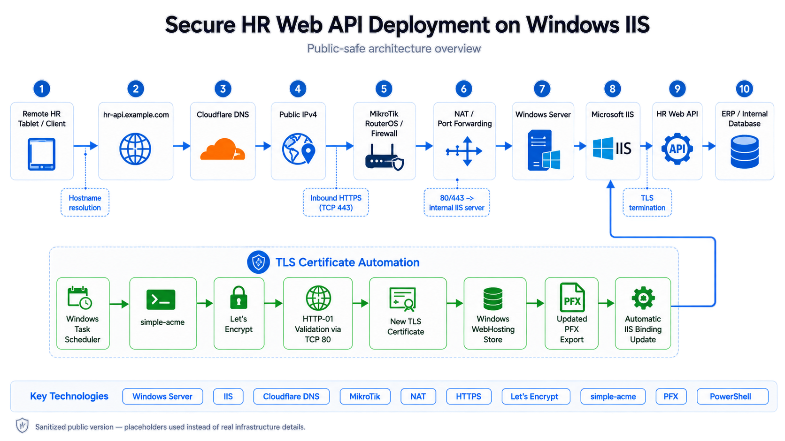

# HR Web API Deployment — DNS, NAT, IIS & Automated TLS Certificate Management

## Overview

This project documents the deployment of a publicly accessible HTTPS endpoint for an internally hosted HR Web API supporting employee time-attendance operations.

Following a change in the HR application's communication architecture, remote tablet clients needed direct connectivity to the API hosted within a Windows Server environment.

The implementation involved DNS configuration, network connectivity troubleshooting, TLS certificate provisioning, and automated certificate lifecycle management.

## Technologies

- Windows Server & Microsoft IIS
- Cloudflare DNS
- MikroTik RouterOS / NAT
- Let's Encrypt & ACME HTTP-01
- simple-acme
- Windows Certificate Store & Task Scheduler
- PowerShell

## Architecture

The following diagram illustrates the HR Web API deployment, including the external HTTPS communication flow and the automated TLS certificate renewal process.

*Sanitized architecture diagram. Production infrastructure identifiers have been replaced with placeholders.*
  

Cloudflare was configured as DNS Only, allowing clients to establish TLS connections directly with the IIS-hosted API.

## Implementation Highlights

1. Identified the server's private network configuration and verified external connectivity.
2. Coordinated the required NAT and port-forwarding rules with the network provider.
3. Configured a dedicated public DNS A record in Cloudflare.
4. Issued a publicly trusted TLS certificate using Let's Encrypt and simple-acme.
5. Coordinated the initial IIS HTTPS binding with the application support team.
6. Configured automated certificate renewal and IIS HTTPS binding updates.
7. Verified the renewal workflow through a successful forced renewal test.

## Results

- Public DNS resolution established
- HTTPS connectivity verified
- TLS certificate successfully provisioned
- Automatic certificate renewal configured
- Automatic IIS certificate rebinding verified
- End-to-end API connectivity tested successfully

## Technical Documentation

For the detailed implementation, configuration steps, validation procedures, and troubleshooting commands, see:

[Full Implementation Documentation](docs/implementation.md)

## Security & Confidentiality

This repository presents a sanitized infrastructure case study.

Production IP addresses, internal hostnames, credentials, private keys, employee data, and sensitive infrastructure identifiers have been excluded or replaced with documentation-only placeholders.
